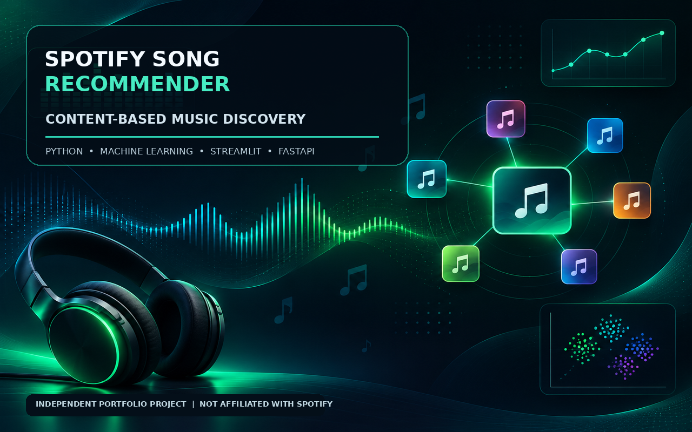
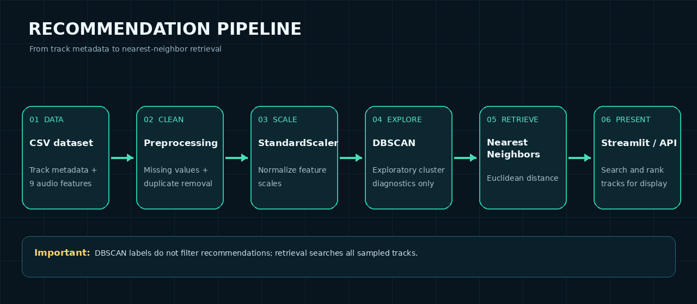

# Spotify Song Recommender

**A content-based music discovery project using standardized audio features and nearest-neighbor retrieval.**



> Independent portfolio project. It is not an official Spotify product and is not affiliated with, endorsed by, or connected to Spotify.

## Overview

This project searches a local music dataset and recommends tracks whose numeric audio-feature vectors are closest to a selected track. It demonstrates a complete applied workflow: data cleaning, feature scaling, exploratory clustering, nearest-neighbor retrieval, a Streamlit interface, and an optional FastAPI service.

## Pipeline



A reference-only capture of the earlier local Streamlit prototype is kept in `screenshots/reference_baseline_user_app.png`. It is not presented as a screenshot of the separately packaged UI in this repository. After running the packaged application on the source dataset, replace it with a fresh, genuine screenshot of this version before using it as the main UI proof in a portfolio.

## Key capabilities

- Search track titles and artist names.
- Select the exact track when multiple matches are returned.
- Retrieve the nearest tracks using Euclidean distance in standardized feature space.
- Optionally exclude tracks by the same artist.
- Inspect track features and open available Spotify track links.
- Use a Streamlit interface or query the optional REST API.
- Keep DBSCAN as exploratory clustering analysis without using its labels as a recommendation filter.

## Dataset and reported notebook results

The supplied Persian notebook's saved run reported:

| Stage | Rows |
|---|---:|
| Original CSV | 2,110,316 |
| After removing incomplete records and duplicate Spotify track IDs | 24,975 |
| Reproducible sample used for modeling | 12,000 |

The notebook used nine audio features: `danceability`, `energy`, `loudness`, `speechiness`, `acousticness`, `instrumentalness`, `liveness`, `valence`, and `tempo`.

After training on the CSV supplied for this portfolio build (2026-11-20), DBSCAN returned 11,635 tracks in cluster `0`, 12 in cluster `1`, 7 in cluster `2`, and 346 noise points (`-1`). The distribution remains strongly imbalanced, so DBSCAN is retained for exploratory diagnostics only. Recommendations are retrieved independently across the sample.

**Reproducibility note:** these counts were freshly reproduced from the supplied 25-column CSV. The CSV itself is not included in this repository; place your licensed local copy at the path shown below.

## How the recommendation engine works

1. Required audio features are converted to numeric values; incomplete rows are removed.
2. Duplicate Spotify track IDs are reduced to one row when IDs are available; records without an ID fall back to `(name, artists)` deduplication.
3. A reproducible sample is selected (`random_state=42`, up to 12,000 tracks).
4. `StandardScaler` scales the nine numeric features.
5. `NearestNeighbors(metric="euclidean")` indexes the standardized vectors.
6. The selected track is queried and itself is excluded from the returned results.

The displayed `feature_distance` is a **ranking signal**. A smaller value means closer numeric feature vectors; it is not a probability, accuracy percentage, or validated measure of listener-perceived similarity.

## Project structure

```text
spotify-song-recommender/
├── README.md
├── app.py
├── api.py
├── train_model.py
├── requirements.txt
├── .gitignore
├── src/
│   ├── __init__.py
│   └── recommender.py
├── notebooks/
│   └── Spotify_Song_Recommender_English.ipynb
├── tests/
│   └── test_recommender.py
├── data/                 # add the licensed CSV locally
├── models/               # generated artifacts; ignored by Git
├── screenshots/
└── docs/                 # Persian portfolio and publishing guides
```

## Setup

Python 3.10+ is recommended.

```bash
git clone <your-repository-url>
cd spotify-song-recommender
python -m venv .venv
```

Activate the environment:

**Windows**
```bash
.venv\Scripts\activate
```

**macOS / Linux**
```bash
source .venv/bin/activate
```

Install packages:

```bash
pip install -r requirements.txt
```

Place the permitted source file at:

```text
data/universal_top_spotify_songs.csv
```

Then train the local artifacts:

```bash
python train_model.py
```

## Run the Streamlit app

```bash
streamlit run app.py
```

## Run the FastAPI service (optional)

In a separate terminal:

```bash
uvicorn api:app --reload --port 8000
```

Open the interactive API docs at `http://127.0.0.1:8000/docs`.

Example workflow:

1. Call `GET /search?query=Ordinary`.
2. Choose a `track_index` from the returned list.
3. Call `GET /recommend?track_index=<index>&top_n=10`.

## Tests

```bash
pytest -q
```

The unit tests use a small synthetic dataset to check search, ranking order, same-artist filtering, invalid indices, and feature-gap labels. They do not validate perceived music quality on the full real dataset.

## Limitations and responsible interpretation

- The model compares nine tabular audio features, not raw audio, lyrics, melody, genre, or user taste.
- Similar feature vectors do not guarantee two tracks sound alike or that a listener will enjoy both.
- No ground-truth relevance labels or user study are included; recommendation quality has not been measured with Precision@K, Recall@K, NDCG, or human judgments.
- DBSCAN's current saved run is strongly imbalanced and is therefore not used as a recommendation constraint.
- The source dataset is not included. Check its origin and redistribution license before adding it to a public repository.
- Spotify links are constructed from `spotify_id` values present in the dataset; the project does not call Spotify's private or restricted recommendation endpoints.

## Technologies

Python · Pandas · NumPy · scikit-learn · StandardScaler · DBSCAN · Nearest Neighbors · Streamlit · FastAPI · Joblib · CSV · Pytest

## Portfolio materials

- Persian project description: [`docs/portfolio_copy_fa.md`](docs/portfolio_copy_fa.md)
- Persian GitHub publishing guide: [`docs/GITHUB_GUIDE_FA.md`](docs/GITHUB_GUIDE_FA.md)
- Technical facts and interview notes: [`docs/project_facts_fa.md`](docs/project_facts_fa.md)

## License and data

No software license has been selected for this repository. Public visibility on GitHub does not by itself grant others permission to reuse the code. The source dataset has a separate license and is not included.
